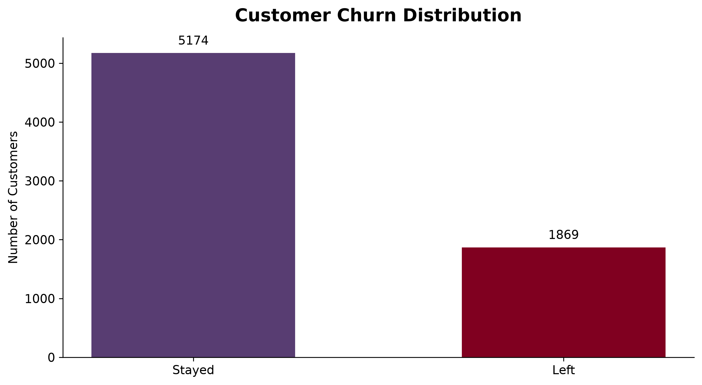
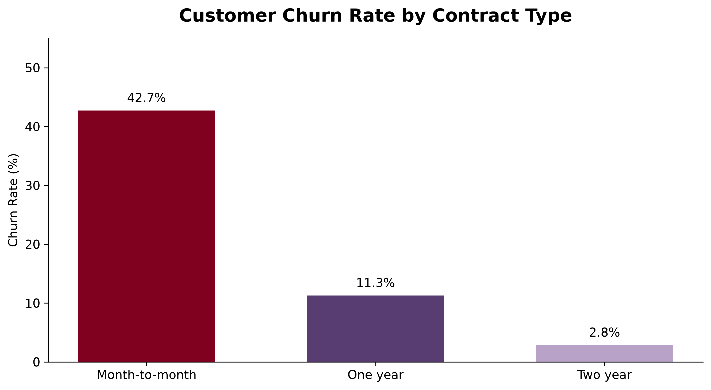
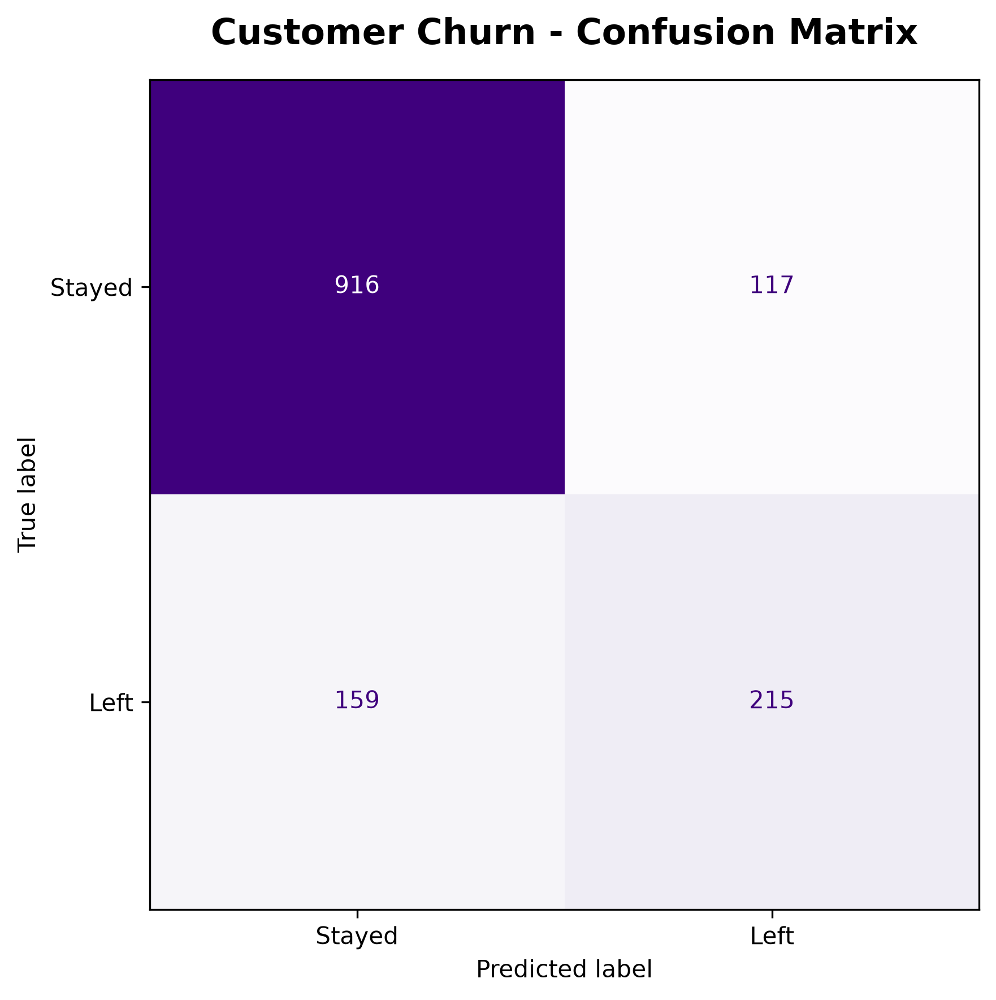
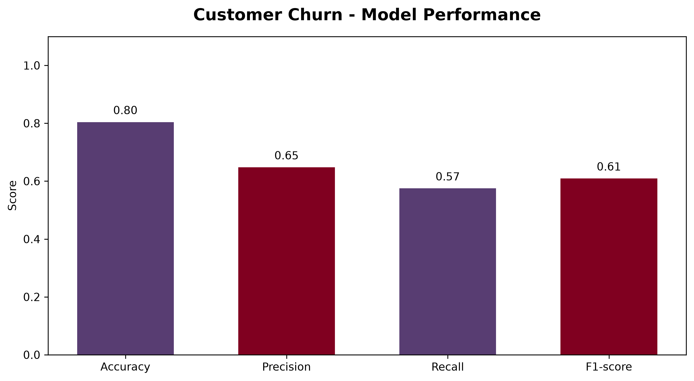
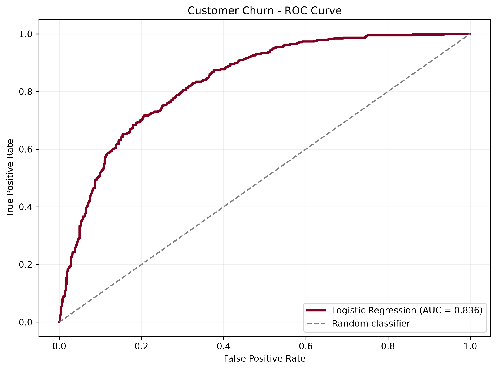

# Customer Churn Prediction

A machine learning project that predicts whether a telecommunications customer is likely to leave a service provider.

## Project Overview

This project analyzes customer demographics, account information, and service usage to identify patterns associated with customer churn.

The goal is to help businesses understand churn risk and support customer retention decisions.

## Technologies Used

- Python 3.14
- Pandas and NumPy
- Matplotlib
- Scikit-learn
- Logistic Regression
- Visual Studio Code

## Dataset

IBM Telco Customer Churn dataset.

- Original dataset: 7,043 customers
- Cleaned dataset: 7,032 customers
- Target variable: `Churn`
- Training data: 80%
- Testing data: 20%

## Project Workflow

1. Explored the dataset and identified missing values.
2. Cleaned and prepared the data for machine learning.
3. Visualized customer churn patterns.
4. Encoded categorical variables.
5. Trained a Logistic Regression classification model.
6. Evaluated model performance using multiple metrics.

## Model Performance

| Metric | Result |
|---|---|
| Accuracy | ADD YOUR SCORE |
| Precision | ADD YOUR SCORE |
| Recall | ADD YOUR SCORE |
| F1-score | ADD YOUR SCORE |
| ROC-AUC | ADD YOUR SCORE |

The model was evaluated on a held-out test dataset.

## Visualizations

### Customer Churn Distribution



### Churn by Contract Type



### Confusion Matrix



### Model Performance



### ROC Curve



## Running the Project

Create a Python 3.14 virtual environment:

```powershell
py -3.14 -m venv .venv
```

Install dependencies:

```powershell
.\.venv\Scripts\python.exe -m pip install -r requirements.txt
```

Run the scripts in order:

```powershell
.\.venv\Scripts\python.exe src\prepare_data.py
.\.venv\Scripts\python.exe src\verify_data.py
.\.venv\Scripts\python.exe src\train_model.py
.\.venv\Scripts\python.exe src\evaluate_model.py
```

## Limitations and Future Improvements

The current saved model expects already encoded customer features. A future improvement is to package the categorical preprocessing and classifier into one complete pipeline that accepts raw customer records.

Other possible improvements include testing additional algorithms, tuning the classification threshold, and examining fairness and model performance across customer groups.

## Author

GitHub: [ktpzclau1](https://github.com/ktpzclau1)